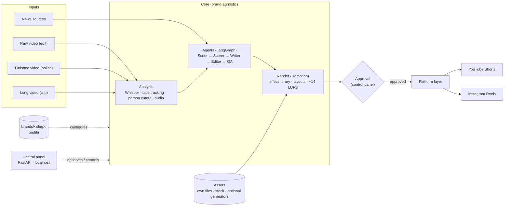

# Architecture

Stagorix has one brand-agnostic core. A brand profile only configures it; it never changes core code. The user watches and approves every step from the control panel.



## Input modes

| Mode | Input | Output |
| --- | --- | --- |
| News | Nothing — Scout scans the brand's sources | Script + voice/recording request + video |
| `edit` | Raw talking-head footage | Cut, captioned video with effects |
| `polish` | Already-edited video | Same video, branded and captioned |
| `clip` | Lecture, stream, podcast | 3–5 short-video candidates |

## Components

| Component | Responsibility | Tech |
| --- | --- | --- |
| Analysis | Word timings, flub detection, face tracking, person cutout, audio cleanup | faster-whisper, OpenCV, rembg, ffmpeg |
| Agents | Scout (collect + dedupe), Scorer, Writer (verify/rewrite loop), Editor (edit plan), QA (`qa-frames`) | Python 3.12, LangGraph, Pydantic |
| LLM adapters | One interface; Claude Code CLI, Anthropic API, OpenAI API, Ollama behind it | Provider-agnostic |
| Render | Edit plan → video; effects and layouts as typed components | Remotion, Three.js, Zod |
| Assets | Own files first, then free stock; license log for every asset; paid generators off by default | Pexels, Pixabay, Mixkit, LottieFiles |
| Control panel | Runs, live agent stream, cost/tokens, approvals, previews, brand wizard | FastAPI + web UI on localhost |
| Storage | Runs, events, assets, license log | SQLite + filesystem; Notion sync optional |
| Platform layer | Per-platform safe areas, text rules, upload | YouTube Data API v3, Instagram API |

## Where things run

| Work | Where | Why |
| --- | --- | --- |
| Text (Scout, Scorer, Writer) | Local, or optionally GitHub Actions | Light; can run on a schedule without the user's machine |
| Media (analysis, render) | Always the local Docker worker (`cpu` or `gpu` profile) | Heavy; pilot showed CPU cutout at 1.6 s/frame, so GPU is optional |

## Brand profile

```
brands/<slug>/
  brand.yaml         name, language(s), tone, platforms
  sources.yaml       news sources for Scout
  tokens.json        colors, fonts, spacing (design tokens)
  motion-system.md   motion language for the Editor agent
  assets/            logo, own media
```

Rule: core code reads only from the profile. Adding a brand means adding a folder, never editing the core.

## Approval points

1. Edit plan (before render)
2. Preview (before final render)
3. Private upload → final publish

Nothing passes an approval point without explicit user action.

## Portability

- One command: `docker compose up` on macOS, Windows (WSL2) and Linux.
- Pinned versions; fonts and models baked into the image.
- Golden test (`stagorix verify`): renders a fixed input and compares against a reference, on all three OSes in CI.
